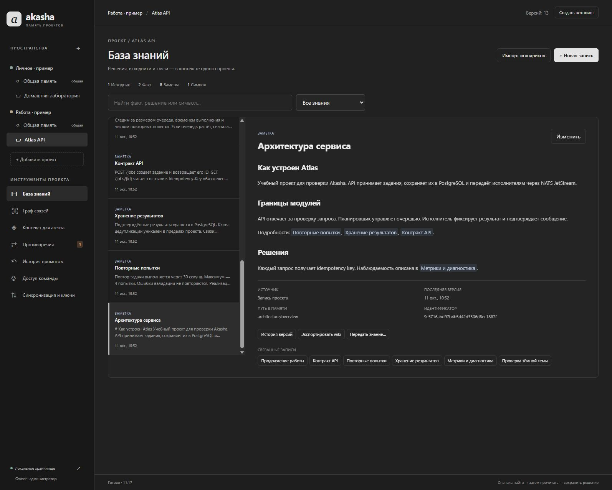
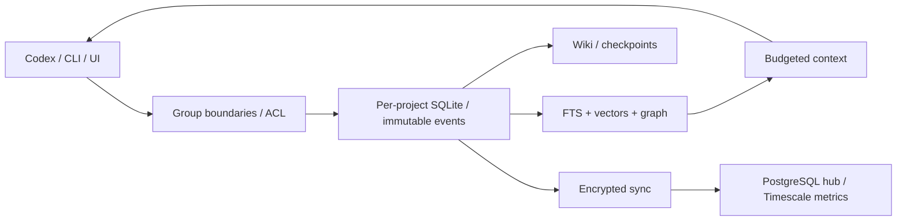
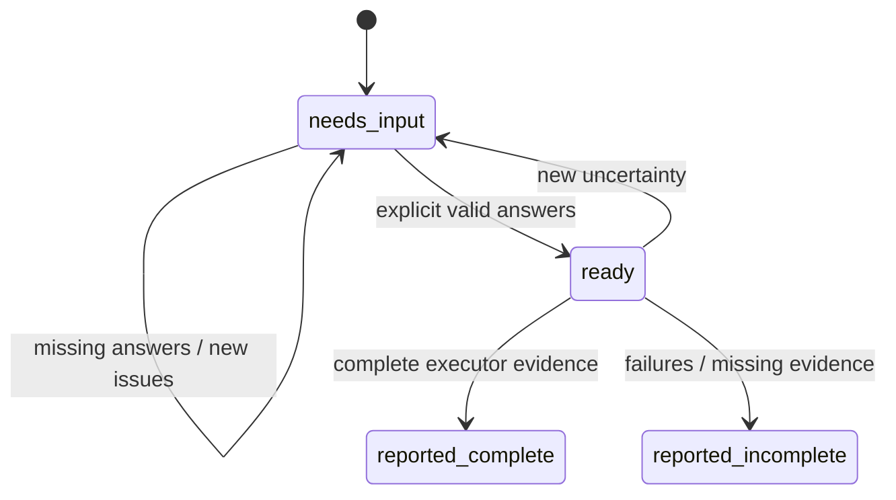

# Akasha

**Project memory for AI coding, Codex integration, and an experimental language of ideas.**

English first, followed by the complete Russian counterpart. / Сначала английская версия, затем полный русский перевод.

[English](#english) · [Русский](#русский)



## English

### 1. Purpose and implementation status

Akasha is durable project memory for AI coding and Codex: decisions, source structure, facts, prompts, skills, checkpoints and encrypted synchronization between computers. It combines an Obsidian-like Markdown/wiki layer with a local knowledge graph, lexical/vector retrieval and context packets constrained by a token budget.

The application is written in **Go** with an embedded JavaScript/CSS UI. Windows and Linux amd64 are supported. The interface uses a Codex-style dark graphite theme without external fonts, CDNs or a JavaScript build pipeline.

The base application reports **0.2.0**. This checkout additionally contains a working experimental **Akasha ilang** composition module, disabled by default. Previous local distribution archives do not automatically contain it: build this source tree. The repository does not contain user databases, credentials, model weights or prebuilt release binaries.

The self-hosted team server has been tested in local Docker fixtures; no public production service is implied. Measurements describe specific fixtures, not guaranteed coding quality or universal token savings.

### 2. Implemented capabilities

| Area | Implementation |
|---|---|
| Project memory | One SQLite database per project; separate catalog and ACL |
| Isolation | Separate work/home roots; shared memory inside each group; explicit authorized knowledge transfers |
| Wiki and hierarchy | Markdown import/export, manifests, `[[wiki links]]`, hierarchical records and typed graph relationships |
| Repository import | Go AST; lexical symbols for other languages; ignores, hashes, incremental changes and deletions |
| Retrieval | FTS5/BM25, local E5 embeddings, exact cosine search, weighted rank fusion, graph ranking |
| Context | Phase budgets, query-aware extraction, deduplication, citations, conflicts, token counts and revision-aware caching |
| History | Immutable versions, project/group prompt history and reusable prompt templates |
| Contradictions | Concurrent alternatives and overlapping structured facts retained until explicit resolution |
| Checkpoints | File-based gzip JSONL snapshots with SHA-256 and automatic checkpoint creation |
| Codex | Official Go MCP SDK, nine standard memory tools, project integration, hooks and conversational skill |
| Team | Accounts, sessions, reader/editor/administrator project roles and preserved concurrent versions |
| Cloud | Docker, PostgreSQL, TimescaleDB, Alembic, encrypted events and explicit source/Git transfer |
| Secrets | Encrypted vault; independent project-key recovery, export and import |
| Skills | Inventory, immutable packages, descriptions, versions, download/install, cloud exchange and capture from work |
| Resources | CPU/RAM detection, bounded pools/queues/buffers, embedding/context caches and byte-limited vector LRU |
| ilang | Atomic/composite skills, clarification gate, master prompt and plan, reports and reusable recipes |

### 3. Architecture and data boundaries

Each group is a separate workspace, such as company or personal projects. Group/project roots must not overlap improperly. Shared memory belongs to its group; work and home are never implicitly pooled. Permissions and project selection apply **before retrieval and caching**.

SQLite supplies embedded offline transactions and FTS5 without a mandatory local database service. PostgreSQL serves concurrent team access. TimescaleDB stores request metrics; Alembic manages schema changes. These are workload-specific choices, not a claim that one database is universally fastest.

The hub receives encrypted events and cannot index plaintext knowledge. Search indexes are rebuildable projections; immutable records are the source of truth. See [architecture](docs/ARCHITECTURE.md), [decisions](docs/DECISIONS.md) and [implementation plan](docs/IMPLEMENTATION_PLAN.md).



### 4. Build and start

Prerequisites: **Go 1.26.4** and Git. Python is for research/validation, not normal application operation. An ordinary build needs no C/C++ compiler. Native embeddings require the separately installed model/runtime.

Build and start on Windows with the commands below. Open `http://127.0.0.1:7341`, obtain the token in another terminal and use it for initial UI access. Then configure your username/password in team access. Keep tokens out of prompts and wiki. Windows protects the local token with the user's DPAPI.

Default data: `%APPDATA%\Akasha`; consistently supply `--data` for a different store. Use `scripts/start.ps1 -Port 7343` if the default port is occupied. Linux defaults to `$XDG_CONFIG_HOME/Akasha` or `~/.config/Akasha`; build `bin/akasha`, run `init`, then `serve --listen 127.0.0.1:7341` and `token`. The local UI binds to loopback.

For a separate demonstration, run `python scripts/demo.py`, then serve and obtain a token using `--data .local/demo` and a free port.

```powershell
git clone https://github.com/J0lhuk/Akasha.git
cd Akasha
go build -trimpath -o bin/akasha.exe ./cmd/akasha
.\scripts\start.ps1
# Another terminal / В другом терминале:
.\bin\akasha.exe token
```

```sh
go build -trimpath -o bin/akasha ./cmd/akasha
./bin/akasha init
./bin/akasha serve --listen 127.0.0.1:7341
# Another terminal / В другом терминале:
./bin/akasha token
```

### 5. Register an existing project

Create the directories before registration. Import builds knowledge from an ongoing repository without executing its code. Go receives AST-based structure; other languages receive explicitly lexical extraction. Reimport uses hashes, tracks changes/deletions and avoids new versions for unchanged contents. Add confirmed decisions with `remember`; imported text is evidence, not executable instructions.

Create a separate group for home projects. Administrators can explicitly transfer selected knowledge between groups with a reason. Credentials stay in the vault, not transferred notes.

```powershell
.\bin\akasha.exe space-add --id work --name Work --root D:\Work
.\bin\akasha.exe project-add --id atlas --space work --name Atlas --root D:\Work\Atlas
.\bin\akasha.exe import --project atlas
.\bin\akasha.exe context --project atlas --query 'payment retries' --phase implement --budget 1500
.\bin\akasha.exe checkpoint --project atlas --reason 'Before handoff'
```

### 6. Codex integration and chat commands

Run `akasha install-codex`, then use the conversational commands below in the project chat. `$akasha add` registers the current project, resolves its group from configured roots or asks you to choose, imports knowledge, checkpoints and merges project MCP/hooks integration. Existing configuration is preserved by the merge/backup workflow; repeating add does not duplicate the project.

The supported invocation is **`$akasha` or selecting it through `/skills`**. Akasha does not register an arbitrary native `/akasha` slash command. Literal `/akasha add`, if delivered to the model, can be interpreted conversationally; native registration is not claimed.

`integration --project atlas --out D:\Work\Atlas\.akasha-integration` generates an inspectable plugin package in a new directory. Review its MCP/hooks/configuration fragments, merge into project `.codex`, verify `/mcp` and approve exact hooks through Codex's normal `/hooks` process. Machine-specific paths must be regenerated on another computer.

Hooks cover SessionStart, UserPromptSubmit, PreCompact, Stop and SessionEnd. The standard server has nine memory tools. Integration does not read hidden Codex databases or restore internal model state. See [Codex integration](docs/CODEX.md).

```text
$akasha add
$akasha context payment retry behavior
$akasha budget implement 1600
$akasha skill-create payment-retry from the completed work
```

### 7. Local vector memory and RAG

RAG retrieves evidence, combines it with project structure and sends a compact cited packet to the coding agent. Akasha retrieves and assembles context; Codex generates answers/code. No external “RAG API” is required.

`model-install` downloads pinned SHA-256-verified files once. Subsequent indexing, embeddings and retrieval run **locally on CPU without model API calls**. Initial downloads require network access; later inference does not. OpenRouter is not integrated and keys from other projects are not copied.

The model is multilingual-e5-small, INT8 ONNX, 384 dimensions, `query:`/`passage:` prefixes, masked mean pooling and L2 normalization. Export revision: `761b726dd34fb83930e26aab4e9ac3899aa1fa78`; ONNX Runtime: 1.24.1. Weights are approximately 118 MB, tokenizer 17 MB, plus native libraries. Windows/Linux amd64 are supported.

`vector-search` uses exact cosine scanning. Hybrid retrieval combines FTS5 and dense ranks with weights 2:1, then context uses graph ranking. Technical identifiers/opaque strings have a lexical guard: semantic similarity does not prove a function exists. Explicit vector search remains available.

Limits: 10,000 current records and 40,000 chunks per project. Raw float32 vectors at that maximum use 61.44 MB, excluding text/metadata/runtime. HNSW and pgvector are **not implemented**. Stale vectors cannot return changed records; stale state is reported and lexical search remains available. See [local RAG](docs/LOCAL_RAG.md).

```powershell
.\bin\akasha.exe model-install
.\bin\akasha.exe model-status
.\bin\akasha.exe vector-index --project atlas
.\bin\akasha.exe vector-search --project atlas --query 'prevent duplicate charges'
.\bin\akasha.exe search --project atlas --query 'retry protection'
.\bin\akasha.exe context --project atlas --query 'review payment retries' --budget 1600
```

### 8. Token economy, prompts and caches

Phase budgets cover `orient`, `plan`, `implement`, `debug`, `review` and `resume`. Packets select relevant complete lines, deduplicate text, preserve citations, identify conflicts and explain omitted evidence. Originals remain intact: compression does not replace history.

`o200k_base` counts packet text, not every model's tokenizer or hidden Codex context. Revision-aware context/graph caches and model-aware embedding caches avoid repeated local computation. **A local cache hit is not a provider billing-cache hit.**

Commands include `budget`, `tokens`, `cache`, `cache-clear`, `prompt-save`, `prompt-list`, `prompt-get`, `prompt-render`, `history`, `prompt-history`. History is available per project or across permitted projects in a group. Prompt templates/skill archives are excluded from automatic evidence retrieval. See [token economy](docs/TOKEN_ECONOMY.md).

### 9. Wiki, checkpoints, contradictions and secrets

`wiki-export`/`wiki-import` maintain Markdown and a manifest. Checkpoints are immutable gzip JSONL event snapshots with checksums, not unsafe copies of live SQLite files. Automatic checkpoints follow modifying CLI operations/hooks; server/MCP maintenance also checkpoints on a 60-second schedule.

Concurrent heads and overlapping structured facts retain both alternatives. `conflicts` lists them; `resolve` records an explanation without erasing history. Two agents can contribute, but external execution is not automatically coordinated.

The vault uses AES-256-GCM and Argon2id password-based key protection. `secret-set`/`secret-get` are separate from memory tools; `key-export`/`key-import` transfer independently encrypted project keys. Recovery kits must preserve keys/passphrases separately from database backups. Losing keys may make data unrecoverable. Never put plaintext passwords in skills, embeddings, prompts, reports or Git. See [security](docs/SECURITY.md).

### 10. Self-hosted cloud, accounts and team access

Copy `.env.example` to `.env`. Generate independent random hex database passwords, an owner recovery token of at least 32 characters and an admin password of at least 12. Do not commit `.env`. Run `docker compose up --build -d`, inspect `docker compose ps` and `http://127.0.0.1:7342/healthz`.

Compose uses PostgreSQL 17 / TimescaleDB 2.30.2. Startup: database health → one-shot Alembic migrations → Go hub. Migration/app roles are separated; the app is not a superuser. PostgreSQL is not exposed externally; the hub binds to host loopback. Configure HTTPS proxy for remote computers.

Reader/editor/administrator project roles determine visibility and edit access. The administrator controls sharing. Local UI and hub accounts are separate. Sessions last 12 hours, at most 20 per user; session secrets are stored by hash. Credential files use DPAPI on Windows or mode 0600 on Unix. Password reset revokes sessions; changing bootstrap `.env` does not reset existing accounts.

Load passwords into the named environment variables securely before the examples below. `hub-account-set` resets passwords; `hub-sessions-revoke` revokes sessions and can disable users.

Encrypted events preserve offline edits and concurrent versions. Explicit capture/restore and Git bundle operations move source files; restore defaults to dry run. A second computer needs a compatible client, authorized hub access and project keys. Database sync alone does not restore keys or hidden Codex conversation state.

Anyone with a project key can decrypt the entire project. Revocation cannot erase downloaded data; use separate projects/keys for different audiences. Back up PostgreSQL, hub-data, client stores and key recovery material, then test restoration. Do not update with `docker compose down -v`. See [accounts/server](docs/ACCOUNTS_SERVER.md) and [operations](docs/OPERATIONS.md).

```powershell
akasha hub-login --url https://memory.example.com --username admin --pass-env AKASHA_ACCOUNT_PASSWORD --out D:\Protected\akasha-session.credential
akasha hub-account-add --url https://memory.example.com --hub-token-file D:\Protected\akasha-session.credential --name 'Developer 2' --username coder2 --pass-env AKASHA_NEW_USER_PASSWORD
akasha hub-grant --url https://memory.example.com --hub-token-file D:\Protected\akasha-session.credential --project atlas --user USER_ID --role editor
akasha hub-stats --url https://memory.example.com --hub-token-file D:\Protected\akasha-session.credential
```

### 11. Versioned skill repository

Skills are shared within the chosen group. Packages retain names, descriptions, authors, version labels and hashes. Different contents with identical names/labels remain separate versions; install chooses an exact ID. Identical publication is idempotent.

Cloud exchange requires configured hub credentials and an unlocked vault. Restore the group's shared-project key on another computer and use `skill-pull`. Differing installed files are preserved; explicit `--replace` first makes a neighboring backup. Validation checks hashes and rejects traversal, symlinks and special files; bundled scripts are not executed.

Limits: 512 files, 4 MiB/file, 16 MiB unpacked, 8 MiB ZIP. Secret scanning is a safeguard, not a guarantee; publication does not certify safety or licensing.

After research/work, ask `$akasha skill-create payment-retry from this work; save locally and in the repository; synchronize with the configured cloud`. The agent distills verified procedures, checks, failure handling and provenance. CLI `skill-create` packages supplied content with `SKILL.md`, evidence, provenance and Codex metadata; it does not itself call an LLM/read hidden chats. Local versions survive upload failures. Generated skills do not activate implicitly across groups. See [skill repository](docs/SKILL_REPOSITORY.md).

```powershell
akasha skill-installed
akasha skill-publish --space work --file 'C:\Users\me\.codex\skills\review' --label '1.0'
akasha skill-list --space work
akasha skill-versions --space work --name review
akasha skill-download --space work --id VERSION_ID --out D:\review-copy
akasha skill-install --space work --id VERSION_ID
akasha skill-sync --space work --url https://memory.example.com
```

### 12. ilang: foundations of the language of ideas

**A previously agreed word becomes a reusable, parameterized skill.** In “create server”, `server` may reference an existing definition like a named function. It is not permission to invent unspecified details: the agent must ask everything unknown, imprecise or ambiguous before producing the master prompt and plan.

The cycle is: **idea → skill/version → questions → explicit answers → master prompt + plan → execution by Codex → evidence and analysis → reusable recipe**.

“Compiler of ideas” means transforming an agreed idea into a master prompt and execution plan, then recording assessment of the result; it does not mean machine-code compilation. The Go compiler deterministically validates, composes, orders and counts tokens. Codex handles natural-language dialogue and execution.

Canonical syntax is JSON with namespace **`akasha.ilang/v1`**. There is no standalone free-form `.ilang` parser yet. Names start with a Latin letter and use letters/digits/underscores/hyphens; case matters. Other ILAng projects do not imply compatibility.

An atomic contract contains name, description, typed parameters/questions, prompt template, checks, effects and evidence. Types are `string`, `integer`, `boolean`, `enum`, `secret_ref`. Values are strings validated by type; enums use `choices`. Secrets use `vault://...` references, never plaintext. **Every parameter needs an explicit answer; no defaults exist.** Last run's port/directory do not silently become next run's answers.

The example below defines a local fixture server, not an already deployed product. You can describe an agreed server procedure during work, name it `server_vide_h`, and later use that definition as a subskill.

```json
{
  "format": "akasha.ilang/v1",
  "name": "server_vide_h",
  "description": "Create and verify an explicitly configured local HTTP server.",
  "parameters": [
    {"name": "directory", "type": "string", "question": "Which directory / В какой папке?"},
    {"name": "port", "type": "integer", "question": "Which local port / На каком порту?"}
  ],
  "prompt": "Create a minimal HTTP server in {{directory}}, bound to 127.0.0.1:{{port}}. GET /healthz must return JSON status=ok. Verify with a real HTTP request.",
  "checks": ["GET /healthz returns HTTP 200 and status=ok"],
  "effects": ["project.write", "network"],
  "evidence": ["Example contract, not a claim of a previously deployed service"]
}
```

### 13. ilang: composition and version resolution

A composite definition uses `steps` instead of `prompt`. Each step has an ID, a pinned child `{name, version}`, arguments and `depends_on`. The structural example below needs a real immutable version ID before use.

Each argument has exactly one source: a parent `input` or explicitly agreed `literal`. Bound input types must match; values must satisfy the receiving contract. Dependencies form a directed acyclic graph; stable topological ordering creates a reproducible sequential plan. Nested compositions expand within limits. Versions never silently upgrade; multiple variants of a name require explicit selection.

Effects are `project.read`, `project.write`, `network`, `deploy`. A composite must declare its children's effects. These describe necessary actions, not permission grants. Dynamic step outputs and distributed parallel execution are outside v1.

Definitions are resolved only in the authorized current project's database. SHA-256 validates definition content; immutable IDs pin versions. Skills and runs are excluded from normal evidence retrieval/embeddings, preventing stored instructions from being mistaken for factual context.

```json
{
  "id": "create_server",
  "skill": {"name": "server_vide_h", "version": "EXACT_REVISION_ID"},
  "arguments": {
    "directory": {"input": "directory"},
    "port": {"literal": "8080"}
  },
  "depends_on": []
}
```

### 14. ilang: questions, compilation and state

States: `needs_input`, `ready`, `reported_complete`, `reported_incomplete`. Missing/invalid parameters, ambiguous versions and agent-supplied `issues` retain `needs_input`. **No master prompt or plan is returned in this state.** If everything is already explicit and valid, preparation can immediately return `ready`.

The agent declares natural-language uncertainties as issues: target audience, deployment environment, downtime, contradictions. Machine validation cannot prove that every ambiguity in arbitrary prose has been found. New uncertainty after planning returns the run to clarification and clears its prior executable packet.

Updates require the current immutable revision. Stale answers are rejected; historical reads return `current:false`. This prevents history overwrites, not concurrent external execution: assign one executor per run.

Compilation checks ACL/flag, exact definitions, parameters, bindings, dependencies and effects; rejects cycles; expands and orders the composition; includes procedures, agreed answers and acceptance criteria in one master prompt. Template substitution is single-pass and does not execute code. The packet stores pinned versions, plan hash, tokenizer and token count. Overflow is an explicit error, not silent removal of criteria. MCP sends full instructions once in content, without duplicating them in structured metadata.

Limits: 32 parameters; 32 steps/definition; 16 nesting levels; 128 expanded nodes; 128 KiB/definition; 512 KiB/master prompt; 512–32,000 text tokens, default 8,000. This budget excludes prior chat, hidden context and protocol overhead. Compilation itself makes no additional LLM API calls; Codex dialogue and execution still spend model tokens.



### 15. ilang: result analysis and capturing a recipe

Codex executes within the user's authorization. The compiler does not run shell commands, model calls, deployments or servers. The executor reports every step as passed/failed/blocked/skipped; passed steps need evidence for every criterion. Reports must match the exact plan hash, contain analysis and retain unresolved issues.

The engine checks coverage and linkage; it does not independently visit evidence URLs or rerun external checks. **`reported_complete` means complete executor-provided confirmations, not independently proven success.** Analysis should reference actual files, tests, commands and observed behavior.

`ilang-capture` creates a reusable parameterized recipe from a complete report, retaining original inputs, exact child versions and provenance. Additional dialogue questions become fresh `clarification_N` parameters; previous answers never become hidden defaults. A fixed condition needs an explicitly authored new definition.

For example: “The server assembled this way will be called `server_vide_h`; save it as a function and use it as a subskill.” Later runs ask its parameters again. Incomplete runs do not automatically become successful recipes; an explicitly authored definition can instead document known limitations.

### 16. ilang: implemented commands and integration

The local feature flag is per project, **off by default** and not synchronized. Build current sources, then explicitly enable it. Standard `--data`, `--project` or project resolution by `--root` apply to these commands.

Use exact question keys in answers, such as `parameters.directory`, `parameters.port`, `issues.exposure`. Read the current revision before updates. Full request/answer/report formats: [integration](ilang/docs/INTEGRATION.md); executable walkthrough: [CLI fixture](ilang/examples/cli_smoke.py).

Restart the project's MCP connection after enable to discover seven added tools: `ilang_catalog`, `ilang_define`, `ilang_prepare`, `ilang_answer`, `ilang_read`, `ilang_report`, `ilang_capture`. Normal mode exposes nine tools, enabled mode sixteen. Disable is checked on every call, including established connections. Updated conversational integration is generated from source; refreshing global installed skills is a separate explicit operation.

Definitions/runs participate in immutable project records, checkpoints and encrypted events, but not retrieval/embeddings. Compatible clients are needed for the new record types. Automatic conversion of composition trees into cross-project `SKILL.md` archives is not implemented: project-local definitions and the package repository are distinct mechanisms.

```powershell
.\bin\akasha.exe ilang-enable --project atlas
.\bin\akasha.exe ilang-status --project atlas
.\bin\akasha.exe ilang-define --project atlas --file ilang/examples/server_vide_h.json
.\bin\akasha.exe ilang-list --project atlas --name server_vide_h
.\bin\akasha.exe ilang-prepare --project atlas --file request.json
.\bin\akasha.exe ilang-answer --project atlas --id CURRENT_REVISION --file answers.json
.\bin\akasha.exe ilang-read --project atlas --id CURRENT_REVISION
.\bin\akasha.exe ilang-report --project atlas --id READY_REVISION --file report.json
.\bin\akasha.exe ilang-capture --project atlas --id REPORT_REVISION --name my_server_recipe
.\bin\akasha.exe ilang-disable --project atlas
```

```json
{
  "skill": {"name": "server_vide_h"},
  "goal": "Create a local server / Создай локальный сервер",
  "issues": [{"id": "exposure", "question": "Who needs access / Кому нужен доступ?"}]
}
```

### 17. ilang: meta skills, ultra meta skills and roadmap

Three levels are distinguished:

- **Skill:** explicit parameters → reusable procedure/result. Contracts and compilation are implemented.
- **Meta skill:** goal + available contracts → interview/composition/evaluation strategy. Documented patterns; the agent authors the composition.
- **Ultra meta skill:** strategy families + experience + external evaluation → improved candidate meta strategies. Research concept; no automatic optimizer is implemented.

Six prompting patterns cover named functions, contract interviews, composition planners, result analysts, skill distillers and offline ultra optimizers. The proposed ultra layer compares candidates against external tests, held-out tasks, token cost and failures; self-evaluation alone cannot certify improvement.

Planned: free-form `.ilang` parser, visual editor, typed dynamic outputs, distributed leases/idempotency, parallel executor and an evaluated ultra optimizer. These are not presented as working features. See [concept](ilang/docs/CONCEPT.md), [language foundations](ilang/docs/LANGUAGE_FOUNDATIONS.md), [meta prompting](ilang/docs/META_PROMPTING.md), [concept plan](ilang/docs/CONCEPT_PLAN.md), [evaluation design](ilang/docs/EVALUATION.md).

### 18. Performance and measurable evidence

CPU topology and available RAM are detected from the OS. Defaults cap import workers and intra-model threads at four with memory-aware limits. Bounded import windows, contiguous vectors, byte-LRU, separate caches, bounded metric queues and controlled password hashing avoid unbounded concurrency. `GOMEMLIMIT` is a soft Go heap limit; native inference uses additional memory. Inspect `akasha resources` and [performance](docs/PERFORMANCE.md).

| Measurement | Recorded result | Scope |
|---|---|---|
| Exact vector scan | 0.92–1.07 ms optimized vs 18.45–21.66 ms before | 1,000 ready vectors × 384; no inference |
| Hybrid context cache | 2.01 ms p95 hit / 239.81 ms p95 miss | Published 1,000-record fixture |
| Context reduction | 89% versus that hybrid fixture's top-five originals | Packet text, not billed tokens/full coding cost |
| Semantic retrieval | Dense 6/6 vs lexical 0/6 in top-five | Six selected native checks |
| ilang validation | 39 top-level tests; 64 passes including subtests; 12 tested packages | Recorded source validation, 2026-10-11 |
| ilang compile | Approximately 1.5–1.7 ms/operation | Warmed four-step composition; three repeats, not p95 |
| ilang packet | 833 tokens; 8,000-token budget | CLI fixture; not the entire conversation |
| Team fixture | 10 accounts, 400 concurrent requests exercised | Local Docker smoke; not a production SLA |

The latest ilang run skipped `TestNativeVectorRetrieval` because `AKASHA_TEST_MODEL_DATA` was unset. It built Windows/Linux candidates, ran Windows CLI and a real MCP SDK connection; the new Linux candidate was compiled but not executed. Earlier native/offline evidence is separate. The end-to-end CLI example uses a controlled Python executor and real loopback HTTP, not a Codex coding benchmark.

See [base validation](reports/VALIDATION.md), [ilang validation](ilang/reports/VALIDATION.md), [benchmark](ilang/reports/benchmark.log), [build manifest](ilang/reports/build-manifest.json). Failed/intermediate results are retained. Total task token savings and coding quality are not yet established by an independent coding benchmark.

### 19. Research and limits of its coverage

Base memory research: **200 nonempty GitHub Repository Search API pages**, 1,732 unique repository references, 328 relevant materials from 31 hosts, 36 README comparisons. Separate ilang research: **100 nonempty GitHub API pages**, 2,662 unique repository references, **573 relevant unique web pages** after screening, 39 hosts/40 source families, deeper comparison of 55 READMEs and 22 full HTML papers.

These are coverage counts, not audits of every repository's code or reproduction of all cited benchmarks. Many pages are official documentation sections, not independent studies. Raw downloaded source texts are excluded from Git; methodology, catalogs and synthesized conclusions are included. Imported public descriptions are redacted where credential-shaped strings occur.

Mechanisms studied include POML, Prompty, LMQL, Guidance, Outlines, BAML, DSPy/GEPA, Meta Prompting, ADAS, ReAct and related skill/context research: typed prompts, constrained generation, prompt programs, reuse and evidence-based evaluation. Citation does not mean every system is implemented.

See [base research](research/RESEARCH_NOTES.md), [ilang method](ilang/research/METHOD.md), [synthesis](ilang/research/SYNTHESIS.md), [catalog](ilang/research/CATALOG.md), [GitHub search](ilang/research/GITHUB_SEARCH.md). Scripts require `requests`, `beautifulsoup4`, `lxml`; public GitHub API collection uses authenticated `gh` without extracting its token.

### 20. Development, verification and repository layout

The commands below run Go checks, the published retrieval evaluation and the bounded ilang validator. The latter builds Windows/Linux candidates, benchmarks and runs a real CLI fixture. Additional smoke scripts cover MCP/hooks, skills, PostgreSQL and offline inference. Some require a specific development binary/model: read documentation first. Native tests require fixture model installation and `AKASHA_TEST_MODEL_DATA`.

Layout: `cmd/` application/evaluation; `internal/` memory, retrieval, auth, sync, UI, integration and ilang; `docs/` architecture/operations/security; `ilang/` concept/contracts/examples/research/reports; `migrations/` Alembic; `scripts/` utilities; `research/` base study; `reports/` measurements/UI evidence; `testdata/` fixtures; `third_party/` and `licenses/` compatibility source and dependency notices.

`.local`, `.env`, binaries, archives, live databases, keys/tokens and raw research downloads are ignored. Do not publish real project data as fixtures. Preserve isolation, immutable history, explicit secret handling and factual measurements.

```powershell
go test ./...
go vet ./...
go run ./cmd/akasha-eval
python -X utf8 ilang/validate.py
```

### 21. Limitations and licensing

Akasha supplies durable project records/resumable packets, not hidden model state or all internal Codex chats. It does not silently trust hooks. Exact vector scan has explicit limits. Compression is deterministic extraction, not a universal LLM summarizer. Preserving concurrent versions is not real-time coediting or a lock on external actions.

ilang has no shell/deploy executor, free-form parser, distributed leases or automatic ultra optimizer. Report completeness is not independent verification. Cloud sync cannot replace a tested backup/recovery kit. Skill publication is not a security audit. No guaranteed percentage of full-task token savings is claimed.

Dependency notices are preserved in [THIRD_PARTY_NOTICES.md](THIRD_PARTY_NOTICES.md) and `licenses/`. No separate license grant for Akasha's own code has been selected yet; public visibility alone does not grant an open-source license. Downloaded models/runtimes retain their own licenses.

---

## Русский

### 1. Назначение и состояние реализации

Akasha — долговременная память проектов для AI-кодинга и Codex: решения, структура исходников, факты, промпты, skills, чекпоинты и шифрованная синхронизация между компьютерами. Она объединяет Markdown/wiki-слой в духе Obsidian, локальный граф знаний, лексический/векторный поиск и пакеты контекста с токенным бюджетом.

Приложение написано на **Go**, интерфейс — встроенные JavaScript/CSS. Поддерживаются Windows и Linux amd64. Интерфейс использует тёмную графитовую тему в стиле Codex без внешних шрифтов, CDN и сборщика JavaScript.

Базовое приложение обозначает версию **0.2.0**. Эти исходники дополнительно содержат работающий экспериментальный модуль композиции **Akasha ilang**, выключенный по умолчанию. Ранее собранные локальные архивы не получают его автоматически: соберите текущие исходники. Репозиторий не содержит пользовательских БД, доступов, весов модели и готовых бинарных релизов.

Сервер команды для самостоятельного размещения проверен в локальных Docker-fixture; публичный production-сервис не подразумевается. Измерения относятся к конкретным наборам, а не гарантируют качество кодинга и универсальную экономию токенов.

### 2. Реализованные возможности

| Область | Реализация |
|---|---|
| Память проектов | Отдельная SQLite-БД каждого проекта; отдельный каталог и ACL |
| Изоляция | Раздельные корни работы/дома; общая память внутри группы; явный разрешённый перенос знаний |
| Wiki и иерархия | Markdown import/export, manifest, `[[wiki-ссылки]]`, иерархические записи и типизированные связи графа |
| Импорт репозитория | Go AST; лексические символы других языков; ignores, хэши, изменения и удаления |
| Поиск | FTS5/BM25, локальные E5 embeddings, точный cosine, взвешенное объединение рангов, граф |
| Контекст | Бюджеты этапов, извлечение по запросу, дедупликация, ссылки, противоречия, токены и кэш по ревизии |
| История | Неизменяемые версии, история промптов проекта/группы, шаблоны промптов |
| Противоречия | Параллельные альтернативы и пересекающиеся факты сохраняются до явного разрешения |
| Чекпоинты | Файловые gzip JSONL-снимки с SHA-256 и автоматическим созданием |
| Codex | Официальный Go MCP SDK, девять обычных инструментов памяти, проектная интеграция, hooks и разговорный skill |
| Команда | Аккаунты, сессии, роли читателя/редактора/администратора проекта, сохранение параллельных версий |
| Облако | Docker, PostgreSQL, TimescaleDB, Alembic, шифрованные события и явный перенос исходников/Git |
| Секреты | Шифрованный vault; отдельное восстановление, экспорт и импорт ключей проекта |
| Skills | Инвентаризация, неизменяемые пакеты, описания, версии, установка, облачный обмен, создание по итогам работы |
| Ресурсы | Определение CPU/RAM, ограниченные пулы/очереди/буферы, кэши embeddings/контекста и byte-LRU векторов |
| ilang | Атомарные/составные skills, обязательные уточнения, мастер-промпт и план, отчёты и повторяемые рецепты |

### 3. Архитектура и границы данных

Группа — отдельное пространство, например проекты компании или личные проекты. Корни групп/проектов не должны недопустимо пересекаться. Общая память принадлежит группе; работа и дом не объединяются неявно. Права и выбор проектов проверяются **до поиска и кэширования**.

SQLite обеспечивает встроенные offline-транзакции и FTS5 без обязательного локального сервиса БД. PostgreSQL обслуживает конкурентную работу команды. TimescaleDB хранит метрики запросов; Alembic управляет схемой. Это выбор под конкретную нагрузку, а не заявление об универсально самой быстрой БД.

Hub получает шифрованные события и не индексирует открытые знания. Поисковые индексы можно пересоздать; источник истины — неизменяемые записи. См. [архитектуру](docs/ARCHITECTURE.md), [решения](docs/DECISIONS.md) и [план реализации](docs/IMPLEMENTATION_PLAN.md).


### 4. Сборка и запуск

Требования: **Go 1.26.4** и Git. Python нужен исследованиям/проверкам, а не обычной работе приложения. Стандартная сборка не требует C/C++-компилятора. Нативные embeddings требуют отдельной установки модели/runtime.

Соберите и запустите Windows-версию командами ниже. Откройте `http://127.0.0.1:7341`, получите токен в другом терминале и войдите в UI. Затем настройте логин/пароль в доступе команды. Не помещайте токены в промпты и wiki. Windows защищает локальный токен через DPAPI пользователя.

Данные по умолчанию: `%APPDATA%\Akasha`; для другого хранилища везде одинаково задавайте `--data`. Если порт занят, используйте `scripts/start.ps1 -Port 7343`. Linux использует `$XDG_CONFIG_HOME/Akasha` или `~/.config/Akasha`: соберите `bin/akasha`, выполните `init`, затем `serve --listen 127.0.0.1:7341` и `token`. Локальный UI слушает loopback.

Для отдельной демонстрации выполните `python scripts/demo.py`, затем запускайте сервер и получайте токен с `--data .local/demo` на свободном порту.

```powershell
git clone https://github.com/J0lhuk/Akasha.git
cd Akasha
go build -trimpath -o bin/akasha.exe ./cmd/akasha
.\scripts\start.ps1
# Another terminal / В другом терминале:
.\bin\akasha.exe token
```

```sh
go build -trimpath -o bin/akasha ./cmd/akasha
./bin/akasha init
./bin/akasha serve --listen 127.0.0.1:7341
# Another terminal / В другом терминале:
./bin/akasha token
```

### 5. Подключение существующего проекта

Создайте каталоги до регистрации. Импорт строит знания по уже разрабатываемому репозиторию без исполнения его кода. Для Go используется AST, для других языков — явно обозначенное лексическое извлечение. Повторный импорт использует хэши, фиксирует изменения/удаления и не создаёт версии неизменившегося содержимого. Подтверждённые решения добавляйте через `remember`; импортированный текст — свидетельство, не инструкция к исполнению.

Для домашних проектов создайте отдельную группу. Администратор может явно перенести выбранные знания между группами с основанием. Доступы остаются в vault, а не переносимых заметках.

```powershell
.\bin\akasha.exe space-add --id work --name Work --root D:\Work
.\bin\akasha.exe project-add --id atlas --space work --name Atlas --root D:\Work\Atlas
.\bin\akasha.exe import --project atlas
.\bin\akasha.exe context --project atlas --query 'payment retries' --phase implement --budget 1500
.\bin\akasha.exe checkpoint --project atlas --reason 'Before handoff'
```

### 6. Интеграция Codex и команды чата

Выполните `akasha install-codex`, затем используйте команды ниже в чате проекта. `$akasha add` регистрирует текущий проект, определяет группу по корням или просит выбрать её, импортирует знания, создаёт чекпоинт и объединяет MCP/hooks. Существующая конфигурация сохраняется механизмом merge/backup; повтор не создаёт дубль проекта.

Поддерживаемый вызов — **`$akasha` или выбор через `/skills`**. Akasha не регистрирует произвольную нативную slash-команду `/akasha`. Если текст `/akasha add` попадает в модель, он может быть понят как разговорная просьба; нативная регистрация не заявляется.

`integration --project atlas --out D:\Work\Atlas\.akasha-integration` создаёт проверяемый пакет плагина в новом каталоге. Просмотрите MCP/hooks/фрагменты настроек, объедините с проектной `.codex`, проверьте `/mcp` и доверьте точные hooks штатно через `/hooks`. Пути зависят от устройства: на другом компьютере пакет создаётся заново.

Hooks охватывают SessionStart, UserPromptSubmit, PreCompact, Stop и SessionEnd. Обычный сервер содержит девять инструментов памяти. Интеграция не читает скрытые БД Codex и не восстанавливает внутреннее состояние модели. См. [интеграцию Codex](docs/CODEX.md).

```text
$akasha add
$akasha context payment retry behavior
$akasha budget implement 1600
$akasha skill-create payment-retry from the completed work
```

### 7. Локальная векторная память и RAG

RAG находит свидетельства, объединяет со структурой проекта и передаёт агенту компактный пакет со ссылками. Akasha ищет и собирает контекст; Codex генерирует ответы/код. Внешний «RAG API» не требуется.

`model-install` однократно скачивает закреплённые файлы с проверкой SHA-256. Последующая индексация, embeddings и поиск работают **локально на CPU без API-вызовов модели**. Первоначальному скачиванию нужна сеть, дальнейшему inference — нет. OpenRouter не подключён, ключи других проектов не копируются.

Модель — multilingual-e5-small, INT8 ONNX, 384 измерения, префиксы `query:`/`passage:`, masked mean pooling, L2 normalization. Ревизия экспорта: `761b726dd34fb83930e26aab4e9ac3899aa1fa78`; ONNX Runtime: 1.24.1. Веса примерно 118 MB, tokenizer 17 MB, плюс нативные библиотеки. Поддерживаются Windows/Linux amd64.

`vector-search` выполняет точный cosine scan. Hybrid объединяет FTS5 и dense-ранги с весами 2:1, затем контекст использует граф. Для технических идентификаторов/непрозрачных строк действует лексическая защита: смысловая близость не доказывает существование функции. Явный векторный поиск доступен.

Лимиты: 10 000 текущих записей и 40 000 фрагментов на проект. Сырые float32-векторы при максимуме занимают 61.44 MB без текста/метаданных/runtime. HNSW и pgvector **не реализованы**. Старые векторы не возвращают изменённые записи; устаревание показывается, лексический поиск доступен. См. [локальный RAG](docs/LOCAL_RAG.md).

```powershell
.\bin\akasha.exe model-install
.\bin\akasha.exe model-status
.\bin\akasha.exe vector-index --project atlas
.\bin\akasha.exe vector-search --project atlas --query 'prevent duplicate charges'
.\bin\akasha.exe search --project atlas --query 'retry protection'
.\bin\akasha.exe context --project atlas --query 'review payment retries' --budget 1600
```

### 8. Экономия токенов, промпты и кэши

Бюджеты этапов: `orient`, `plan`, `implement`, `debug`, `review`, `resume`. Пакеты выбирают релевантные целые строки, убирают повторы, сохраняют ссылки, показывают противоречия и объясняют пропуски. Оригиналы остаются: сжатие не заменяет историю.

`o200k_base` считает текст пакета, а не токенизатор любой модели и скрытый контекст Codex. Кэши контекста/графа учитывают ревизии, embeddings — модель, исключая повторные локальные вычисления. **Локальный cache hit не является попаданием в оплачиваемый кэш провайдера.**

Команды: `budget`, `tokens`, `cache`, `cache-clear`, `prompt-save`, `prompt-list`, `prompt-get`, `prompt-render`, `history`, `prompt-history`. История доступна по проекту и разрешённым проектам группы. Шаблоны/архивы skills исключены из автоматического поиска свидетельств. См. [экономию токенов](docs/TOKEN_ECONOMY.md).

### 9. Wiki, чекпоинты, противоречия и секреты

`wiki-export`/`wiki-import` поддерживают Markdown и manifest. Чекпоинты — неизменяемые gzip JSONL-снимки событий с контрольными суммами, не небезопасные копии работающей SQLite. Автосохранение выполняется после изменяющих CLI-операций/hooks; обслуживание сервера/MCP также создаёт снимки по 60-секундному расписанию.

Параллельные heads и пересекающиеся структурированные факты сохраняют обе альтернативы. `conflicts` показывает их; `resolve` записывает пояснение без стирания истории. Два агента могут работать над проектом, но внешнее исполнение не координируется автоматически.

Vault использует AES-256-GCM и защиту ключа паролем через Argon2id. `secret-set`/`secret-get` отделены от памяти; `key-export`/`key-import` переносят независимо зашифрованные ключи проекта. Recovery kit должен хранить ключи/парольные фразы отдельно от backup БД. Потеря ключей может сделать данные невосстановимыми. Не помещайте открытые пароли в skills, embeddings, промпты, отчёты и Git. См. [безопасность](docs/SECURITY.md).

### 10. Своё облако, аккаунты и доступ команды

Скопируйте `.env.example` в `.env`. Создайте независимые случайные hex-пароли БД, recovery-token владельца от 32 символов и пароль администратора от 12. Не коммитьте `.env`. Выполните `docker compose up --build -d`, проверьте `docker compose ps` и `http://127.0.0.1:7342/healthz`.

Compose использует PostgreSQL 17 / TimescaleDB 2.30.2. Запуск: здоровье БД → одноразовые Alembic-миграции → Go hub. Роли миграции/приложения разделены; приложение не superuser. БД не открыта наружу; hub слушает loopback хоста. Для других компьютеров настройте HTTPS proxy.

Роли читателя/редактора/администратора проекта определяют видимость и редактирование. Администратор управляет доступом. Аккаунты локального UI и hub отдельные. Сессии живут 12 часов, максимум 20 на пользователя; секреты сессий хранятся по хэшу. Credential-файлы используют DPAPI в Windows или 0600 в Unix. Сброс пароля отзывает сессии; изменение стартового `.env` не сбрасывает существующий аккаунт.

Перед примерами безопасно загрузите пароли в указанные переменные окружения. `hub-account-set` сбрасывает пароль; `hub-sessions-revoke` отзывает сессии и может отключить пользователя.

Шифрованные события сохраняют offline-правки и параллельные версии. Явные capture/restore и Git bundle переносят исходники; restore по умолчанию dry run. Второму компьютеру нужны совместимый клиент, доступ к hub и ключи проекта. Синхронизация БД не восстанавливает ключи и скрытое состояние чата Codex.

Обладатель ключа расшифровывает весь проект. Отзыв доступа не стирает скачанное; для разных аудиторий нужны разные проекты/ключи. Резервируйте PostgreSQL, hub-data, клиентские хранилища и recovery-материалы, проверяйте восстановление. Не обновляйте через `docker compose down -v`. См. [аккаунты/сервер](docs/ACCOUNTS_SERVER.md) и [эксплуатацию](docs/OPERATIONS.md).

```powershell
akasha hub-login --url https://memory.example.com --username admin --pass-env AKASHA_ACCOUNT_PASSWORD --out D:\Protected\akasha-session.credential
akasha hub-account-add --url https://memory.example.com --hub-token-file D:\Protected\akasha-session.credential --name 'Developer 2' --username coder2 --pass-env AKASHA_NEW_USER_PASSWORD
akasha hub-grant --url https://memory.example.com --hub-token-file D:\Protected\akasha-session.credential --project atlas --user USER_ID --role editor
akasha hub-stats --url https://memory.example.com --hub-token-file D:\Protected\akasha-session.credential
```

### 11. Версионный репозиторий skills

Skills общие внутри выбранной группы. Пакеты сохраняют имена, описания, авторов, метки версий и хэши. Разное содержимое одинакового имени/метки остаётся отдельными версиями; установка выбирает точный ID. Повторная публикация одинакового идемпотентна.

Обмен требует настроенных credential hub и открытого vault. На другом компьютере восстановите ключ shared-проекта группы и используйте `skill-pull`. Отличающиеся установленные файлы сохраняются; явный `--replace` сначала создаёт соседний backup. Проверяются хэши, запрещаются traversal, symlinks и специальные файлы; скрипты пакета не исполняются.

Лимиты: 512 файлов, 4 MiB/файл, 16 MiB распакованного, 8 MiB ZIP. Поиск секретов — дополнительная защита, не гарантия; публикация не подтверждает безопасность/лицензию.

После исследования/работы попросите `$akasha skill-create payment-retry по итогам работы; сохрани локально и в репозитории; синхронизируй с настроенным облаком`. Агент выделяет проверенную процедуру, проверки, обработку ошибок и происхождение. CLI `skill-create` упаковывает предоставленный текст с `SKILL.md`, свидетельствами, provenance и метаданными Codex; сам он не вызывает LLM/не читает скрытые чаты. При ошибке отправки локальные версии сохраняются. Созданные skills не активируются неявно между группами. См. [репозиторий skills](docs/SKILL_REPOSITORY.md).

```powershell
akasha skill-installed
akasha skill-publish --space work --file 'C:\Users\me\.codex\skills\review' --label '1.0'
akasha skill-list --space work
akasha skill-versions --space work --name review
akasha skill-download --space work --id VERSION_ID --out D:\review-copy
akasha skill-install --space work --id VERSION_ID
akasha skill-sync --space work --url https://memory.example.com
```

### 12. ilang: основы языка описания идей

**Заранее согласованное слово становится повторно используемым параметризованным skill.** В просьбе «создай server» слово `server` может ссылаться на определение как именованная функция. Это не разрешение придумать неизвестные детали: до мастер-промпта и плана агент должен спросить всё неизвестное, неточное и неоднозначное.

Цикл: **идея → skill/версия → вопросы → явные ответы → мастер-промпт + план → исполнение Codex → свидетельства и анализ → повторяемый рецепт**.

«Компилятор идей» означает преобразование согласованной идеи в мастер-промпт и план с записью анализа результата, а не машинную компиляцию. Go-компилятор детерминированно проверяет, объединяет, упорядочивает и считает токены. Естественный диалог и исполнение выполняет Codex.

Канонический синтаксис — JSON, namespace **`akasha.ilang/v1`**. Самостоятельного свободного парсера `.ilang` пока нет. Имена начинаются с латинской буквы и используют буквы/цифры/подчёркивания/дефисы; регистр важен. Другие ILAng-проекты не означают совместимости.

Атомарный контракт содержит имя, описание, типизированные параметры/вопросы, шаблон промпта, проверки, эффекты и свидетельства. Типы: `string`, `integer`, `boolean`, `enum`, `secret_ref`. Значения передаются строками и проверяются по типу; enum использует `choices`. Секреты — ссылки `vault://...`, не открытые значения. **Каждый параметр требует явного ответа; defaults отсутствуют.** Порт/папка прошлого запуска не становятся ответами следующего автоматически.

Пример ниже описывает локальный учебный сервер, не ранее развёрнутый продукт. Во время работы можно описать согласованный способ сборки сервера, назвать его `server_vide_h` и впоследствии использовать как подскилл.

```json
{
  "format": "akasha.ilang/v1",
  "name": "server_vide_h",
  "description": "Create and verify an explicitly configured local HTTP server.",
  "parameters": [
    {"name": "directory", "type": "string", "question": "Which directory / В какой папке?"},
    {"name": "port", "type": "integer", "question": "Which local port / На каком порту?"}
  ],
  "prompt": "Create a minimal HTTP server in {{directory}}, bound to 127.0.0.1:{{port}}. GET /healthz must return JSON status=ok. Verify with a real HTTP request.",
  "checks": ["GET /healthz returns HTTP 200 and status=ok"],
  "effects": ["project.write", "network"],
  "evidence": ["Example contract, not a claim of a previously deployed service"]
}
```

### 13. ilang: композиция и разрешение версий

Составное определение использует `steps` вместо `prompt`. Шаг содержит ID, закреплённый дочерний `{name, version}`, аргументы и `depends_on`. Структурному примеру ниже перед использованием нужен реальный ID неизменяемой версии.

Аргумент имеет ровно один источник: родительский `input` или явно согласованный `literal`. Типы входов должны совпадать; значения — соответствовать контракту получателя. Зависимости образуют направленный ациклический граф; стабильная топологическая сортировка создаёт воспроизводимый последовательный план. Вложенные композиции разворачиваются в пределах лимитов. Версии не обновляются скрыто; несколько вариантов имени требуют явного выбора.

Эффекты: `project.read`, `project.write`, `network`, `deploy`. Композиция обязана объявить эффекты подскиллов. Это описание действий, не выдача разрешений. Динамические выходы шагов и распределённое параллельное исполнение вне v1.

Определения разрешаются только в доступной БД текущего проекта. SHA-256 проверяет содержимое; неизменяемые ID закрепляют версии. Skills и запуски исключены из обычного поиска свидетельств/embeddings, чтобы сохранённые инструкции не становились фактами контекста.

```json
{
  "id": "create_server",
  "skill": {"name": "server_vide_h", "version": "EXACT_REVISION_ID"},
  "arguments": {
    "directory": {"input": "directory"},
    "port": {"literal": "8080"}
  },
  "depends_on": []
}
```

### 14. ilang: вопросы, компиляция и состояния

Состояния: `needs_input`, `ready`, `reported_complete`, `reported_incomplete`. Недостающие/неверные параметры, неоднозначные версии и переданные агентом `issues` сохраняют `needs_input`. **Мастер-промпт и план в этом состоянии не возвращаются.** Если всё уже явно и корректно, подготовка сразу даёт `ready`.

Агент объявляет неясности естественного языка вопросами: аудитория, окружение развёртывания, простой, противоречия. Машинная проверка не доказывает обнаружение каждой неоднозначности произвольного текста. Новая неизвестность после плана возвращает запуск к уточнениям и очищает прежний исполняемый пакет.

Обновления требуют текущей неизменяемой ревизии. Устаревшие ответы отклоняются; историческое чтение возвращает `current:false`. Это предотвращает перезапись истории, а не внешнее параллельное исполнение: назначайте одного исполнителя запуску.

Компиляция проверяет ACL/флаг, точные определения, параметры, связи, зависимости и эффекты; запрещает циклы; разворачивает и упорядочивает композицию; включает процедуры, согласованные ответы и критерии в один мастер-промпт. Подстановка однопроходная и не исполняет код. Пакет сохраняет версии, хэш плана, токенизатор и токены. Переполнение — явная ошибка, не тихое удаление критериев. MCP передаёт инструкции один раз в content, не дублируя в structured metadata.

Лимиты: 32 параметра; 32 шага/определение; 16 уровней; 128 развёрнутых узлов; 128 KiB/определение; 512 KiB/мастер-промпт; 512–32 000 токенов текста, по умолчанию 8 000. Бюджет не включает прошлый чат, скрытый контекст и протокол. Компиляция не делает дополнительных LLM API-вызовов; диалог и исполнение Codex продолжают тратить токены модели.


### 15. ilang: анализ результата и сохранение рецепта

Codex исполняет в пределах авторизации пользователя. Компилятор не запускает shell, модели, deploy и серверы. Исполнитель сообщает каждый шаг как passed/failed/blocked/skipped; passed требует свидетельства каждого критерия. Отчёт должен совпадать с хэшем плана, содержать анализ и сохранять открытые вопросы.

Движок проверяет полноту и привязку; сам не посещает ссылки и не повторяет внешние проверки. **`reported_complete` означает полноту предоставленных исполнителем подтверждений, не независимо доказанный успех.** Анализ должен ссылаться на реальные файлы, тесты, команды и поведение.

`ilang-capture` создаёт параметризованный рецепт из полного отчёта, сохраняя исходные входы, точные версии подскиллов и происхождение. Дополнительные вопросы становятся новыми параметрами `clarification_N`; прошлые ответы не превращаются в скрытые defaults. Постоянное условие требует явно написанной новой версии.

Например: «Сервер, собранный так, будет называться `server_vide_h`; сохрани как функцию и используй подскиллом». Следующие запуски снова спросят параметры. Неполные запуски автоматически не становятся успешными рецептами; явно описанное определение может зафиксировать известные ограничения.

### 16. ilang: реализованные команды и интеграция

Флаг локальный, отдельный для проекта, **по умолчанию выключен**, не синхронизируется. Соберите текущие исходники, затем явно включите. Команды используют обычные `--data`, `--project` или определение проекта по `--root`.

Ответы используют точные ключи вопросов: например `parameters.directory`, `parameters.port`, `issues.exposure`. Перед обновлением прочитайте текущую ревизию. Форматы запросов/ответов/отчётов: [интеграция](ilang/docs/INTEGRATION.md); работающий пример: [CLI-fixture](ilang/examples/cli_smoke.py).

После включения перезапустите MCP проекта, чтобы обнаружить семь tools: `ilang_catalog`, `ilang_define`, `ilang_prepare`, `ilang_answer`, `ilang_read`, `ilang_report`, `ilang_capture`. Обычно tools девять, после включения шестнадцать. Выключение проверяется в каждом вызове, включая уже открытые соединения. Обновлённая разговорная интеграция генерируется из исходников; обновление глобальных skills — отдельная явная операция.

Определения/запуски входят в неизменяемые записи, чекпоинты и шифрованные события, но не retrieval/embeddings. Клиенты должны поддерживать новые типы. Автоматическое преобразование композиции в межпроектные архивы `SKILL.md` не реализовано: проектные определения и репозиторий пакетов — разные механизмы.

```powershell
.\bin\akasha.exe ilang-enable --project atlas
.\bin\akasha.exe ilang-status --project atlas
.\bin\akasha.exe ilang-define --project atlas --file ilang/examples/server_vide_h.json
.\bin\akasha.exe ilang-list --project atlas --name server_vide_h
.\bin\akasha.exe ilang-prepare --project atlas --file request.json
.\bin\akasha.exe ilang-answer --project atlas --id CURRENT_REVISION --file answers.json
.\bin\akasha.exe ilang-read --project atlas --id CURRENT_REVISION
.\bin\akasha.exe ilang-report --project atlas --id READY_REVISION --file report.json
.\bin\akasha.exe ilang-capture --project atlas --id REPORT_REVISION --name my_server_recipe
.\bin\akasha.exe ilang-disable --project atlas
```

```json
{
  "skill": {"name": "server_vide_h"},
  "goal": "Create a local server / Создай локальный сервер",
  "issues": [{"id": "exposure", "question": "Who needs access / Кому нужен доступ?"}]
}
```

### 17. ilang: мета skills, ультра мета skills и развитие

Различаются три уровня:

- **Skill:** явные параметры → повторяемая процедура/результат. Контракты и компиляция реализованы.
- **Мета skill:** цель + доступные контракты → стратегия опроса/композиции/оценки. Паттерны описаны; композицию пишет агент.
- **Ультра мета skill:** семейства стратегий + опыт + внешняя оценка → улучшенные кандидаты метастратегий. Исследовательская концепция; автоматического оптимизатора нет.

Шесть паттернов: именованная функция, интервью по контракту, планировщик композиции, аналитик результата, выделение skill, offline ультра-оптимизатор. Предлагаемый ультра-уровень сравнивает кандидатов по внешним тестам, отложенным задачам, стоимости токенов и ошибкам; самооценка не подтверждает улучшение.

Планируется: свободный парсер `.ilang`, визуальный редактор, типизированные динамические выходы, распределённые leases/идемпотентность, параллельный исполнитель, проверяемый ультра-оптимизатор. Они не выдаются за работающие функции. См. [концепцию](ilang/docs/CONCEPT.md), [основы языка](ilang/docs/LANGUAGE_FOUNDATIONS.md), [метапромптинг](ilang/docs/META_PROMPTING.md), [план концепции](ilang/docs/CONCEPT_PLAN.md), [план оценки](ilang/docs/EVALUATION.md).

### 18. Производительность и измеримые свидетельства

Топология CPU и доступная RAM определяются из ОС. По умолчанию работники импорта и внутримодельные потоки ограничены четырьмя с учётом памяти. Ограниченные окна импорта, непрерывные векторы, byte-LRU, отдельные кэши, очереди метрик и контролируемое хэширование исключают неограниченную конкуренцию. `GOMEMLIMIT` — мягкий предел Go heap; native inference расходует дополнительную память. См. `akasha resources` и [производительность](docs/PERFORMANCE.md).

| Измерение | Зафиксированный результат | Область |
|---|---|---|
| Точный vector scan | 0.92–1.07 ms после оптимизации против 18.45–21.66 ms до | 1 000 готовых векторов × 384; без inference |
| Hybrid context cache | 2.01 ms p95 hit / 239.81 ms p95 miss | Опубликованный fixture на 1 000 записей |
| Сокращение контекста | 89% против top-five оригиналов этого hybrid-fixture | Текст пакета, не оплаченные токены/весь кодинг |
| Смысловой поиск | Dense 6/6 против lexical 0/6 в top-five | Шесть выбранных native-проверок |
| Проверка ilang | 39 верхнеуровневых тестов; 64 passes с подтестами; 12 пакетов | Зафиксированная проверка исходников 2026-10-11 |
| Компиляция ilang | Около 1.5–1.7 ms/операцию | Прогретая композиция из четырёх шагов; три повтора, не p95 |
| Пакет ilang | 833 токена; бюджет 8 000 | CLI-fixture, не вся переписка |
| Командный fixture | Проверены 10 аккаунтов, 400 конкурентных запросов | Локальный Docker smoke, не production SLA |

Последний ilang-прогон пропустил `TestNativeVectorRetrieval`, поскольку `AKASHA_TEST_MODEL_DATA` не задан. Собраны кандидаты Windows/Linux, запущены Windows CLI и реальное MCP SDK-соединение; новый Linux-кандидат собран, но не исполнен. Прежние native/offline-свидетельства отдельные. Сквозной CLI-пример использует контролируемый Python-исполнитель и реальный loopback HTTP, не benchmark кодинга Codex.

См. [базовую проверку](reports/VALIDATION.md), [проверку ilang](ilang/reports/VALIDATION.md), [benchmark](ilang/reports/benchmark.log), [manifest](ilang/reports/build-manifest.json). Неудачные/промежуточные результаты сохранены. Экономия всей задачи и качество кодинга пока не подтверждены независимым coding benchmark.

### 19. Исследование и границы его охвата

Базовое исследование: **200 непустых страниц GitHub Repository Search API**, 1 732 уникальные ссылки на репозитории, 328 релевантных материалов с 31 хоста, 36 сравнений README. Отдельное исследование ilang: **100 непустых страниц GitHub API**, 2 662 уникальные ссылки на репозитории, **573 релевантные уникальные веб-страницы** после отбора, 39 хостов/40 семейств, подробнее сопоставлены 55 README и 22 полных HTML-статьи.

Это числа охвата, не аудит кода каждого репозитория и не воспроизведение всех benchmarks. Многие страницы — разделы документации, не независимые исследования. Сырые скачанные тексты исключены из Git; методика, каталоги и выводы включены. В импортированных публичных описаниях строки, похожие на доступы, редактируются.

Изучены POML, Prompty, LMQL, Guidance, Outlines, BAML, DSPy/GEPA, Meta Prompting, ADAS, ReAct и связанные исследования: типизированные промпты, ограниченная генерация, программы промптов, повторное использование, оценка по свидетельствам. Упоминание не означает реализации каждой системы.

См. [базовое исследование](research/RESEARCH_NOTES.md), [методику ilang](ilang/research/METHOD.md), [синтез](ilang/research/SYNTHESIS.md), [каталог](ilang/research/CATALOG.md), [GitHub-поиск](ilang/research/GITHUB_SEARCH.md). Скриптам нужны `requests`, `beautifulsoup4`, `lxml`; публичный GitHub API собирается через авторизованный `gh` без извлечения токена.

### 20. Разработка, проверка и структура репозитория

Команды ниже запускают Go-проверки, опубликованную оценку retrieval и ограниченный validator ilang. Последний собирает Windows/Linux-кандидаты, выполняет benchmarks и настоящий CLI-fixture. Дополнительные smoke-скрипты проверяют MCP/hooks, skills, PostgreSQL и offline inference. Некоторые требуют конкретный development binary/модель: сначала прочитайте документацию. Native-тестам нужны fixture-модель и `AKASHA_TEST_MODEL_DATA`.

Структура: `cmd/` приложение/оценка; `internal/` память, поиск, auth, sync, UI, интеграция, ilang; `docs/` архитектура/эксплуатация/защита; `ilang/` концепция/контракты/примеры/исследование/отчёты; `migrations/` Alembic; `scripts/` утилиты; `research/` базовое исследование; `reports/` измерения/UI; `testdata/` fixture; `third_party/`, `licenses/` исходники совместимости и лицензии зависимостей.

`.local`, `.env`, бинарники, архивы, живые БД, ключи/токены и сырые загрузки игнорируются. Не публикуйте реальные данные как fixture. Сохраняйте изоляцию, неизменяемую историю, явную работу с секретами и честные измерения.

```powershell
go test ./...
go vet ./...
go run ./cmd/akasha-eval
python -X utf8 ilang/validate.py
```

### 21. Ограничения и лицензирование

Akasha предоставляет долговременные записи/пакеты продолжения, не скрытое состояние модели и всю внутреннюю историю Codex. Она не доверяет hooks незаметно. Точный scan имеет лимиты. Сжатие — детерминированное извлечение, не универсальный LLM-суммаризатор. Параллельные версии — не совместный редактор реального времени и не блокировка внешних действий.

У ilang нет shell/deploy-исполнителя, свободного парсера, распределённых leases и автоматического ультра-оптимизатора. Полнота отчёта — не независимая проверка. Cloud sync не заменяет проверенный backup/recovery kit. Публикация skill — не аудит защиты. Гарантированная экономия токенов всей задачи не заявляется.

Лицензии зависимостей сохранены в [THIRD_PARTY_NOTICES.md](THIRD_PARTY_NOTICES.md) и `licenses/`. Отдельная лицензия собственного кода Akasha пока не выбрана; публичность сама по себе не даёт open-source лицензию. Скачиваемые модели/runtime сохраняют свои лицензии.

---

## Contacts / Контакты

- Telegram: [@ctepx](https://t.me/ctepx)
- Email / Почта: [ctepx2001@gmail.com](mailto:ctepx2001@gmail.com)
