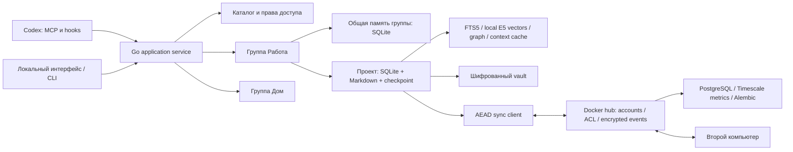

# Akasha: устройство системы

Событие — источник истории. Текущая запись — набор причинных heads. Индекс и граф пересоздаются из событий. Markdown — читаемое представление с явным импортом правок; ошибки экспорта не скрывают успешную запись в БД и восстанавливаются повторным export. Checkpoint содержит версии памяти и summary, не изменяет исходный код.

Получение контекста начинается с авторизации в выбранной группе. Поиск и граф выполняются только по разрешённым БД. Секретные записи не индексируются. Пакет содержит источники, версии, конфликты, пропуски и токенный бюджет. Кэши инвалидируются при изменении выбранных источников.

Синхронизация — журнал идемпотентных зашифрованных событий, а не копирование работающих DB-файлов. Сервер выдаёт возрастающий cursor; клиент продвигает его только после успешной проверки и транзакционного применения. На сервере роли и пользователи управляются отдельно от клиентской памяти: событие памяти не может выдать автору admin-права.

Перенос исходников и восстановление — отдельные операции. Импорт кода не исполняет build scripts и не копирует секретные файлы в индекс. При конфликте восстановления старая версия сохраняется; удаления не выполняются молча. Ограничения исключений отображаются в manifest.

## Retrieval и векторный индекс

В 0.2 реализован retrieval-augmented workflow: FTS5/BM25, локальные E5 embeddings и граф → отбор свидетельств → бюджетированный пакет → Codex. Установка модели — отдельная сетевая операция; последующий поиск не обращается во внешний API. Точные одиночные технические идентификаторы используют лексические свидетельства.

В каждой проектной БД есть отдельный векторный индекс. SQLite/события остаются источником истины; векторы пересоздаваемы. Ключ кэша — проект, хэш фрагмента, версия chunker, модель и её версия. Обновление инкрементальное; смена модели не смешивает несовместимые пространства векторов. Секреты, шаблоны и исполняемые skills не являются автоматическим контекстом. ACL применяется до выбора кандидатов.

Сравнение BM25/dense и hybrid, сохранность фактов, токены и p95 опубликованы в [VALIDATION](../reports/VALIDATION.md). Используется weighted RRF и точный cosine scan; универсальный оптимум и качество произвольного кода не заявляются. Отдельный vector server не требуется. [Подробности модели/лимитов](LOCAL_RAG.md), [ресурсы](PERFORMANCE.md), [SQLite FTS5](https://www.sqlite.org/fts5.html), [Hybrid queries](https://qdrant.tech/documentation/search/hybrid-queries/).

## Облачный сервер и skills

Серверный каталог, ACL, аккаунты и шифрованные события находятся в PostgreSQL; временные метрики — в Timescale hypertable. Alembic выполняет последовательные миграции отдельной ролью. Hub не получает открытые embeddings/ключи. Локальный каталог и память работают без сервера; синхронизируются события, а не открытые файлы БД. [Учётные записи и схема эксплуатации](ACCOUNTS_SERVER.md).

Skills — неизменяемые архивы в shared-проекте группы. Версии различаются хэшем содержимого; создание из итогов работы добавляет provenance и снимок свидетельств. Архивы не исполняются и не подмешиваются в retrieval. Явные создание/публикация/установка сохраняют границы группы. [Команды](SKILL_REPOSITORY.md).

## Опциональная композиция ilang

`internal/ilang` хранит определения-функции и конкретные запуски отдельно от evidence (`ilang_skill`, `ilang_run`). Имена разрешаются только в выбранной БД проекта после ACL; подскиллы закрепляют версии. Неизвестные параметры и диалоговые issues блокируют выдачу мастер-промпта и плана. После ответов Go разворачивает конечную композицию, проверяет зависимости/типы и бюджетирует готовый текст. Codex исполняет план и записывает наблюдения; Akasha проверяет полноту отчёта. По явной команде рецепт сохраняется под новым именем.

Флаг включения локален, по умолчанию false, не переносится с checkpoint/событиями. В обычном режиме MCP не добавляет tools ilang. Определения/запуски синхронизируются как записи проекта и не меняют retrieval revision. [Контракт интеграции и границы](../ilang/docs/INTEGRATION.md), [исследование](../ilang/research/SYNTHESIS.md).
