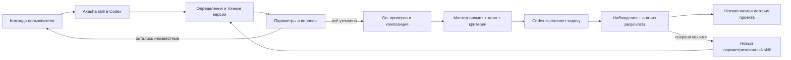

# Интеграция композиции с Akasha и Codex

Реализованный модуль: `internal/ilang`. Хранилище: существующая БД проекта, типы записей `ilang_skill` и `ilang_run`; local feature flag — таблица `state`. Нового сервера БД и отдельного языка исполнения не добавлено.



## Фактически доступные команды

Все команды используют обычные `--data`, `--project` либо определение проекта по `--root`.

| CLI | Действие |
|---|---|
| `ilang-status` | Прочитать локальный флаг |
| `ilang-enable` / `ilang-disable` | Явно включить/выключить режим для проекта на этом компьютере |
| `ilang-define --file definition.json` | Сохранить новую неизменяемую версию атомарного/составного skill |
| `ilang-list [--name server_vide_h]` | Просмотреть определения и версии; имя сравнивается точно |
| `ilang-prepare --file request.json` | Создать сохраняемый запуск: вопросы либо готовый пакет |
| `ilang-answer --id REVISION --file answers.json` | Применить ответы или добавить новые вопросы к текущей ревизии |
| `ilang-read --id REVISION` | Прочитать запуск; `current:false` обозначает исторический снимок |
| `ilang-report --id REVISION --file report.json` | Сохранить проверки и анализ относительно конкретного плана |
| `ilang-capture --id REPORT_REVISION --name server_vide_h` | Сохранить рецепт успешного по отчёту запуска под именем |

MCP добавляет семь инструментов только при включённом режиме на старте сервера: `ilang_catalog`, `ilang_define`, `ilang_prepare`, `ilang_answer`, `ilang_read`, `ilang_report`, `ilang_capture`. По умолчанию остаются девять прежних memory tools. После enable требуется перезагрузка проектного MCP для обнаружения новых tools; disable проверяется в каждом вызове и действует также на уже подключённый клиент.

CLI выдаёт полный сохраняемый JSON запуска. MCP передаёт текст инструкций один раз: content содержит вопросы, готовый мастер-промпт либо итоговый отчёт; structuredContent — только revision, run_id, current, status, plan_hash и счётчики. Вложенный план уже включён в мастер-промпт и повторно в metadata не отправляется. Проверка MCP сравнивает число токенов реально отправленного текста с бюджетированным пакетом.

Обновлён генератор разговорного skill `internal/integration/skill.go`. После установки этой версии команды доступны как `$akasha ilang ...`; естественные просьбы переводит агент, читая инструкцию. Новая собственная slash-команда Codex не регистрируется. Глобальные настройки Codex, trust hooks и уже установленный skill не переписываются данной разработкой автоматически.

## Данные файлов

Пример просьбы:

```json
{
  "skill": {"name": "server_vide_h"},
  "goal": "Создай локальный сервер",
  "issues": [{"id": "exposure", "question": "Кому должен быть доступен сервер?"}]
}
```

Ответы передаются по ключам возвращённых вопросов:

```json
{
  "values": {
    "parameters.directory": "D:/Projects/MyService",
    "parameters.port": "8080",
    "issues.exposure": "Только этому компьютеру, 127.0.0.1"
  }
}
```

При `needs_input` `master_prompt` и `plan` отсутствуют. `ready` содержит пакет, число токенов `o200k_base`, бюджет и хэш. Текстовый бюджет не ограничивает всю прошлую переписку, скрытый контекст или лимит аккаунта Codex.

Для возобновления после сбоя перечитайте текущую ревизию и фактическое состояние файлов/сервисов. Обновление записи с устаревшим ID отклоняется. Этот контроль защищает историю; блокировка одновременного внешнего исполнения двумя агентами и распределённые leases в этой версии не реализованы. Команда должна назначать одного исполнителя конкретному запуску.

## Повторное использование и синхронизация

Рецепт из завершённого запуска сохраняет исходные входы и версии подскиллов. Дополнительные вопросы диалога превращаются в новые параметры `clarification_N`; прошлые ответы не становятся скрытыми defaults. Если нужно сделать конкретное условие постоянным, пользователь явно описывает новую версию определения.

Определения и запуски входят в существующие checkpoints и зашифрованные события проекта. Контроль ACL выполняется до открытия БД и чтения версии. Они исключены из обычного retrieval и не изменяют его revision. На другом компьютере использовать данные нужно совместимой версией Akasha с поддержкой этих типов записей; старый клиент может отклонить новый тип. Флаг включения не входит в события и checkpoints.

Отдельные пакеты SKILL.md, их публикация и облачная синхронизация уже обслуживаются репозиторием skills Akasha. В этой поставке ilang-композиция сохраняется и синхронизируется в своём проекте; автоматическое преобразование её дерева в переносимый межпроектный SKILL.md-архив не реализовано. Общий каталог имён разных проектов не создаётся неявно.

## Что остаётся будущим расширением

Полноценный свободный `.ilang` parser, визуальный редактор, типизированные динамические выходы шагов, параллельный исполнитель с leases/идемпотентностью внешних эффектов и ультра-оптимизатор. Прямой вызов известного рецепта сейчас не требует дополнительного LLM API внутри Akasha; диалог и исполнение Codex продолжают расходовать его обычные токены.
