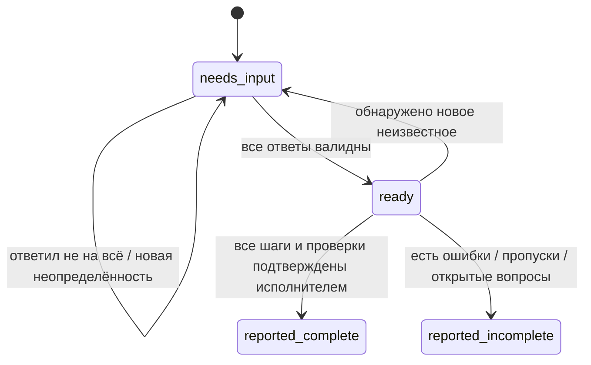

# Семантика первой реализации

Namespace: `akasha.ilang/v1`. Каноническое представление — JSON. Имена: латинские буквы, цифры, `_`, `-`; регистр значим. `server_vide_h` — корректное имя. Разговорный русский ввод обслуживает skill Codex, а не отдельный статистический парсер Akasha.

## Определение

Skill содержит `name`, `description`, `parameters`, `checks`, `effects`, `evidence` и один из двух вариантов реализации:

- атомарный: `prompt` с подстановками `{{parameter}}`;
- составной: `steps`, каждый с собственным `id`, ссылкой `skill: {name, version}`, `arguments` и `depends_on`.

Параметр имеет `name`, `type` и `question`. Типы: `string`, `integer`, `boolean`, `enum`, `secret_ref`. Значения передаются строками; целые числа и булевы значения проверяются, enum ограничен `choices`. Секрет передаётся только ссылкой `vault://...`, не значением. **У всех объявленных параметров должен быть явный ответ. Defaults отсутствуют.** «Не требуется» — тоже явное согласованное значение, если контракт допускает его.

Аргумент подскилла имеет ровно один источник: `literal` — согласованная константа; либо `input` — имя параметра родителя. Типы связываемых параметров должны совпадать; конкретное значение также проверяется по контракту получателя. Динамические ссылки на выходы инструментов не входят в v1.

Проверки — конкретные ожидаемые результаты, например «GET /healthz возвращает 200». Их формулировка не является доказательством выполнения. Итоговый отчёт содержит отдельное свидетельство для каждой пройденной проверки.

## Разрешение имён и хранение

Ищем только в текущей разрешённой БД проекта, после проверки ACL. Версия — ID неизменяемой записи; SHA-256 подтверждает содержимое определения. Разное содержимое одного имени создаёт разные доступные версии. Точная ссылка никогда не обновляется автоматически. Составной skill требует закреплённых версий всех подскиллов.

Определения и состояния запусков — отдельные неиндексируемые записи. Они входят в обычный журнал событий, checkpoints и синхронизацию проекта, но не в поиск свидетельств и не в embeddings. Флаг включения хранится локально и не синхронизируется.

## Состояния запуска

Первый вызов может сразу дать `ready`, если все параметры и уточнения уже предоставлены. Для `needs_input` поля мастер-промпта и плана отсутствуют. Ответы обновляют только указанную текущую ревизию запуска; устаревший ответ не перезаписывает работу другого агента. Продолжение закрытого запуска требует нового запуска.

Машинная проверка обнаруживает отсутствующие параметры, ошибки типов, неоднозначный выбор версии, неизвестные ссылки, циклы и превышение лимитов. Агент отдельно передаёт `issues` — неясности естественного языка, противоречия и вопросы об окружении. Отсутствие issues в JSON не доказывает ясность произвольного пользовательского текста.

## Формирование плана

1. Проверить флаг и ACL; разрешить имя и закрепить версию.
2. Собрать все вопросы. Не предполагать ответы из похожего проекта.
3. Проверить типы, привязки, зависимости и допустимые эффекты композиции.
4. Развернуть подскиллы в конечный упорядоченный план. Порядок стабилен; первая версия исполняется последовательно через Codex.
5. Включить процедуры, параметры, критерии результата и согласованные уточнения в мастер-промпт. Подстановки выполняются один раз, без выполнения кода.
6. Посчитать токены готового текста. При превышении заданного бюджета не обрезать критерии молча, а запросить изменение бюджета/состава.
7. Сохранить план, закреплённые версии, вопросы/ответы и хэш пакета в журнал запуска.

Лимиты: 32 шага на определение, 16 уровней вложенности, 128 развёрнутых шагов, 32 параметра, 128 KiB на определение, 512 KiB на мастер-промпт, до 32000 токенов в готовом тексте. Протокольный JSON и предыдущая история Codex находятся вне этого текстового бюджета.

Эффекты (`project.read`, `project.write`, `network`, `deploy`) описывают требуемые действия, но не выдают разрешений. Составное определение перечисляет все эффекты подскиллов. Действия выполняются в исходной авторизации пользователя и среде Codex. Сам компилятор не запускает shell, модели или серверы.

## Анализ и сохранение результата

Отчёт связан с конкретной ревизией запуска и хэшем плана. Для каждого шага: результат, проверки и ссылки на свидетельства. Akasha вычисляет полноту отчёта; содержательный анализ записывает Codex, сопоставив реальные результаты с заданием. Статус `reported_complete` означает полноту **предоставленных** подтверждений, не независимое выполнение проверок движком.

По явной команде `capture` из завершённого запуска создаётся новое имя рецепта. Сохраняются исходные параметры и точные версии зависимостей; значения одного запуска не превращаются скрыто в defaults. Ссылка на отчёт добавляется к происхождению. Из неполного запуска готовый рецепт автоматически не создаётся; его можно явно описать как отдельное определение с известными ограничениями.
